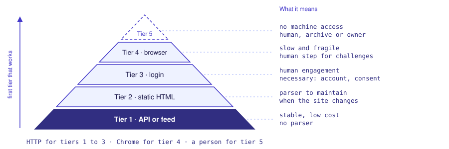

# accesspath

accesspath audits a website for two readers. For a **collector**, it finds the simplest way to read the content: a feed, an API, a sitemap, static HTML, or a browser as the last step. For the **site owner**, it shows what the site exposes to machines and how it is protected, with recommendations. It is the engine of the Claude Code skill `/sap`.

## What it does

Use accesspath before you write a collector, or when a source stops you: a 403, a page that JavaScript makes, an anti-bot wall. accesspath examines the site and writes a **Site Architecture Profile** (SAP). The profile gives the rendering, the access points, the anti-bot vendor, the rate limit, `robots.txt` and the legal frame. It also recommends an access tier.

accesspath tries the tiers from the base to the top and keeps the first tier that works. Tier 1 is an API or a feed: RSS, Atom, JSON, GraphQL, sitemap. Tier 4 is a single-page application that needs Chrome. Tier 5 is a site that stops Chrome too: a person, an archive copy or the owner must help.



## Owner report

`sap owner <url>` reads the same audits from the side of the site owner. Each finding gives what a machine sees, with the evidence, its state (open and declared, open but not declared, protected, inconsistent, outside the protection perimeter) and what to do, in both directions: close what is not wanted, or declare what is wanted. Six themes: what the site declares to machines, consistency between declaration and exposure, open doors, protection, copies outside the protection perimeter, cost for human visitors.

The report does not test the strength of the protection, does not look for vulnerabilities and gives no way around a protection. Use it on your own sites, or on the sites of a client who asked for it.

## Website auditing

accesspath audits a site in steps, from the cheapest to the most expensive. It first reads what the site publishes for machines: `robots.txt`, the sitemap, the feeds and the APIs. Then it reads the home page without a browser. It opens Chrome only when these steps do not give the answer. Each step stops when the path is clear.

Sometimes the analysis of a site needs a person. More and more sites protect themselves against automated traffic: a challenge page, a CAPTCHA, a login, a consent banner. A machine must not go around these doors, but a person can open them. accesspath includes this human step in its pipeline:

- the audit sees the step in advance and announces it at the top of the report, with its kind and the estimated time;
- the step goes into a queue, so that a person can do all the steps at a convenient time;
- the person does the step in a browser that accesspath opens and keeps for the site, also from a different computer;
- accesspath reads the page again, and marks the site as ready only when the content is really served;
- the collector then works in this prepared browser, on the same machine.

A human step belongs to the upper tiers: a login (tier 3), a consent banner on a site that needs a browser (tier 4), and an anti-bot challenge (tier 5). A block page or a redirect to a different site is not a human step: a person cannot change it.

## Quick start

```bash
gh repo clone lfoletti/accesspath ~/Documents/accesspath
~/Documents/accesspath/skill/install.sh
```

The script links the skill to `~/.claude/skills/sap`, makes `.venv` from `requirements.lock` and does a test of the `sap` command. In Claude Code, type `/sap <url>`.

Without the skill:

```bash
python -m accesspath sap probe https://www.example.org            # find the access points (about 1 minute, no browser)
python -m accesspath sap inspect https://www.example.org --headless   # full audit in Chrome
python -m accesspath sap owner https://www.example.org     # owner report: exposure, protection, recommendations
python -m accesspath sap probe https://www.example.org --save --skeleton   # keep the profile, write a collector skeleton
```

Without the skill, install with `pip install -e ".[inspect,tls]"`; the command `accesspath` is the same as `python -m accesspath`.

You need Python 3.11 or later. `inspect` needs Google Chrome.

## Commands

| Command | Input | Function |
|---|---|---|
| `sap probe` | URL | Finds feeds, APIs, platform doors, static HTML and the rate limit. It does not open a browser. |
| `sap inspect` | URL | Opens Chrome. Finds the anti-bot vendor, the framework, the network calls and the legal frame. |
| `sap owner` | URL | Owner report: what the site exposes to machines, its protection, and what to do. |
| `sap batch` | file of URLs | Audits a list of sites in parallel. Writes `results.jsonl` and `summary.md`. |
| `sap rehearse` | name | Replays the selected strategy and writes the result in the profile. |
| `sap verify` | name or `--all` | Audits a known profile again: PASS, WARN or FAIL. |
| `sap diff` | name | Compares the two last audits of a site. |
| `sap show` | name or `--all` | Shows the profile and the last audit. |
| `ghost` | name | Changes a recorded browser session (HAR) into calls that you can replay. |
| `warmup`, `gestes` | name | Prepares a Chrome profile. Lists the human steps that wait. |

Without `--save`, accesspath writes nothing. Use this mode from other projects.

## Main functions

- **Platform doors.** `probe` reads the home page first. It uses the links that the site declares (RSS, Atom, JSON Feed, oEmbed) and the doors of the platform (Shopify, WordPress, Squarespace, Webflow).
- **TLS fingerprint.** Some sites refuse Python but accept Chrome. When the home page refuses Python, `probe` sends one request that copies the TLS fingerprint of Chrome (`curl_cffi`). If this request passes, the profile gets `tls_fingerprint: chrome`.
- **Third-party copies.** When no door opens, `probe` asks the Wayback Machine and Common Crawl for their copies of the site.
- **Human step.** Some sites need a person: a challenge, a login, a consent page. `inspect` shows "✋ Geste humain requis" and the command to use. With `--save`, the step goes into a queue.
- **Ghost mode.** Record a browser session as HAR. `ghost --har` finds the data calls and their pagination. `ghost --replay` sends these calls again without a browser. Secrets come from environment variables and accesspath never writes them to disk.
- **Patterns and templates.** Collector projects and studies leave reusable knowledge: content URL families, CMS profiles, ranked templates (the winning combinations of choices, with their variants), known platforms (commercial registers, commune CMS, site CMS), and patterns learned after each campaign. See [docs/patterns.md](docs/patterns.md).
- **Disputed access.** accesspath does not refuse a disputed access, for example the replay of a logged-in session. The report shows a warning.

## Safety

The reports go into the context of an AI agent. Because of this, accesspath treats all site data as dangerous.

- accesspath removes control characters from site data and puts the data between the markers `DATA_BEGIN` and `DATA_END`.
- accesspath refuses internal addresses for the target and for each redirect.
- Each response has a size limit (10 MiB on the wire, 50 MiB decoded) and a time limit.
- accesspath reads `robots.txt` first. It stops a burst at the first 429 or 503.

## Tests

```bash
.venv/bin/python -m pytest -m "not network"
.venv/bin/ruff check .
.venv/bin/ruff format --check .
```

The tests do not use the internet. They use local fixtures and servers on 127.0.0.1.

## More information

- [docs/REFERENCE.md](docs/REFERENCE.md): installation from the lock files, configuration, data, collector projects, CI.
- [docs/patterns.md](docs/patterns.md): patterns, ranked templates, known platforms, learned patterns, and how the project uses them.
- [docs/VEILLE.md](docs/VEILLE.md): how the technology watch changes the code.
- [skill/SKILL.md](skill/SKILL.md): the `/sap` skill.

## License

MIT. See [LICENSE](LICENSE). Contributions: [CONTRIBUTING.md](CONTRIBUTING.md). Security: [SECURITY.md](SECURITY.md).
